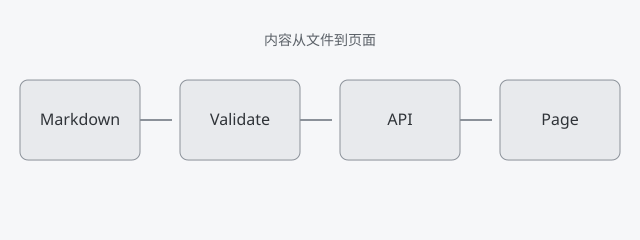

## 结论

带本地图片的笔记使用目录形式：`index.md` 和 `images/` 放在一起。正文写相对路径，渲染时统一改写为 `/content-assets/notes/<slug>/...`，这样内容目录可以整体移动。

## 它解决什么问题

如果正文直接写 `/images/foo.png`，图片就脱离了笔记目录。迁移内容、复制一篇笔记或换部署路径时，图片很容易丢。相对路径把一篇笔记变成一个可以整体备份的单元。

这个示例的目录结构：

```text
content/notes/demo-image/
  index.md
  images/pipeline.svg
```

正文引用：

```md

```

## 一次小实验

启动开发服务器后打开这篇笔记，图片地址会变成：

```text
/content-assets/notes/demo-image/images/pipeline.svg
```

直接请求这个地址：

```bash
curl -sI http://localhost:3000/content-assets/notes/demo-image/images/pipeline.svg
```

响应应包含 `Content-Type: image/svg+xml`。资源路由会先确认 slug 对应一篇已发布内容，再在笔记目录内解析文件；路径跳出目录会返回 404。


## 限制

图片随内容目录一起部署，构建镜像时必须把 `content/` 复制进去。内容很多时，镜像会变大；大量图片更适合对象存储和 CDN。

资源路由只允许固定扩展名，也不处理图片压缩。需要响应式图片时，要在内容层之外再加一套处理流程。

## 适合谁

适合图片不多、希望内容自包含的个人站点。每篇笔记的 Markdown 和图片在同一个目录里，备份和迁移都不需要额外步骤。
